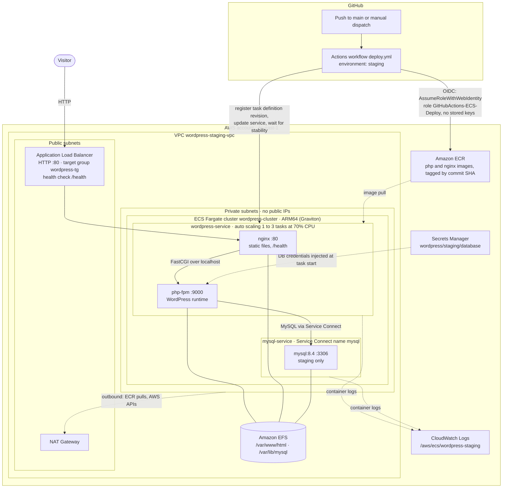

# wordpress-ecs

WordPress on AWS ECS Fargate (staging), deployed via GitHub Actions with OIDC.

**Live staging site:** http://wordpress-alb-1569660740.us-east-1.elb.amazonaws.com
(HTTP only — see [production-gap-analysis.md](docs/production-gap-analysis.md)
for why HTTPS isn't there yet). Health check:
http://wordpress-alb-1569660740.us-east-1.elb.amazonaws.com/health

**New to this project or rebuilding it from scratch?** Start with
[docs/step-by-step-guide.md](docs/step-by-step-guide.md) — it walks through
every step in build order with the exact commands used, the real bugs that
came up, and how to verify each piece actually works before moving to the
next. Everything in it was run against a real AWS account, not just planned.

## Architecture



Solid arrows are request and deployment paths; dotted arrows are supporting flows. The load balancer serves HTTP only, and MySQL on EFS is a staging shortcut; both are covered in [docs/production-gap-analysis.md](docs/production-gap-analysis.md). Account-specific identifiers are left out of the diagram.

<details>
<summary>Plain-text version</summary>

```
Internet
   |
   v
  ALB (public subnets, HTTP/HTTPS)
   |
   v
ECS Fargate Cluster (wordpress-cluster)
   |
   +-- wordpress-service (private subnets, no public IP)
   |     task: nginx (:80) + php-fpm (:9000, localhost)
   |     shared EFS mount -> /var/www/html
   |     ARM64 (Graviton) - see step-by-step-guide.md phase E for why this matters
   |
   +-- mysql-service (private subnets, no public IP)
         task: mysql:8.4
         EFS mount -> /var/lib/mysql (staging/testing only, see below)
         reachable from wordpress-service as "mysql" via ECS Service Connect

GitHub -> OIDC -> IAM role (GitHubActions-ECS-Deploy) -> ECR -> ECS -> CloudWatch
```

</details>

**Database note:** MySQL runs as its own ECS service on EFS for this staging/testing
environment only. That is a deliberate lab shortcut, not the production recommendation.
Production should point WordPress at Aurora/RDS MySQL instead — see
[docs/production-gap-analysis.md](docs/production-gap-analysis.md).

## Repository structure

```
.github/workflows/deploy.yml     GitHub Actions: build, push, deploy
nginx/                           Nginx image (reverse proxy + static assets + /health)
php/                             PHP-FPM image (WordPress runtime)
ecs/                             ECS task definition templates (WordPress, MySQL)
docs/                            Implementation report, test results, gap analysis, runbook
```

WordPress core files are not committed to this repo (see `.gitignore`) — they are
initialized directly onto the EFS filesystem the running tasks mount.

## Local development

Build and smoke-test the containers without touching AWS:

```bash
docker build -t wordpress-php:local ./php
docker build -t wordpress-nginx:local ./nginx
```

See [docs/testing-results.md](docs/testing-results.md) for the local Nginx +
PHP-FPM + MySQL wiring test (same container images, run the way they run in
one ECS task) and its results.

## Deployment model

- Images are tagged with the Git commit SHA, never `latest`.
- Each deploy registers a new ECS task definition revision referencing the new
  SHA-tagged images, then updates the service — so rolling back means
  redeploying the previous task definition revision.
- GitHub authenticates to AWS via OIDC (`sts:AssumeRoleWithWebIdentity`), scoped
  to this repo's `staging` environment. No long-lived AWS keys in GitHub.
- Database credentials live in AWS Secrets Manager (`wordpress/staging/database`)
  and are injected into the task via `secrets`, never passed through GitHub.

## Documentation

- [docs/step-by-step-guide.md](docs/step-by-step-guide.md) — build this from scratch, step by step, with real commands and the bugs to expect
- [docs/implementation-report.md](docs/implementation-report.md) — what was built, why, and how it was verified
- [docs/testing-results.md](docs/testing-results.md) — pass/fail evidence for every test
- [docs/production-gap-analysis.md](docs/production-gap-analysis.md) — staging vs. production-grade design
- [docs/runbook.md](docs/runbook.md) — operating this environment day to day
